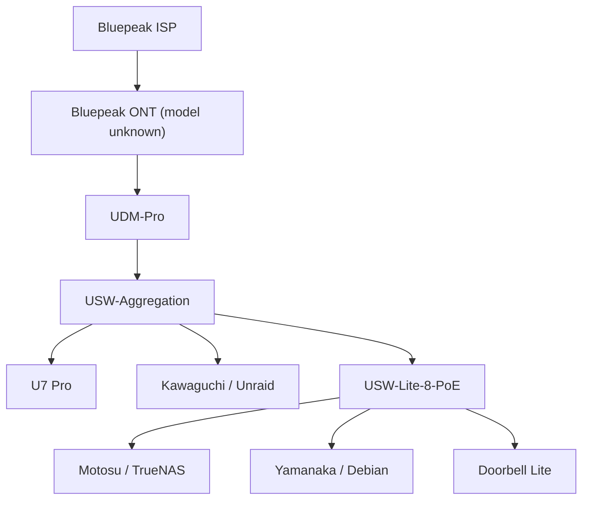
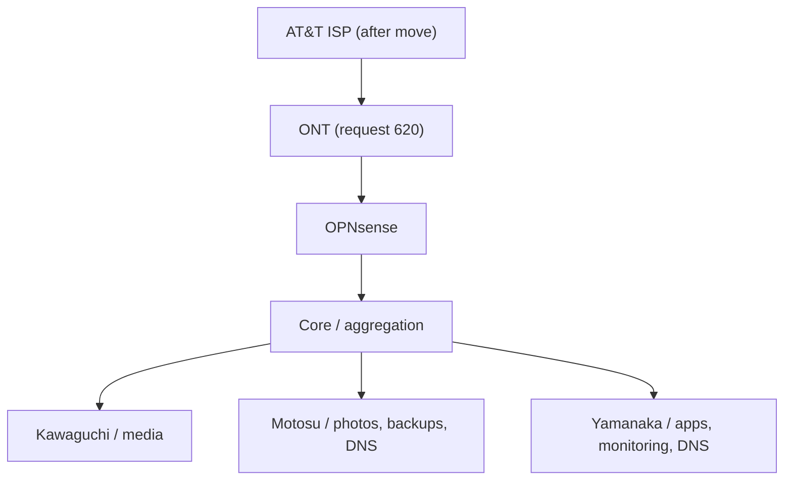

# topology

Recorded production connections and target physical layout. Equipment state, DNS, ingress, segmentation, and power policy are maintained in [network](README.md).

## current topology

- U7 Pro is attached to the aggregation switch and has a 2.5 GbE-capable uplink.
- Kawaguchi uses 10 GbE to the aggregation layer.
- Motosu and Yamanaka reach the aggregation switch through USW-Lite-8-PoE.
- Exact switch-port assignments remain private.

## target topology

This is target state, not current wiring or evidence that Motosu DNS is deployed. The 620 ONT is a planned request. Equipment purchase/deployment states and ISP plans are in [network](README.md#target-network); resolver state is in [DNS](README.md#dns).

If UniFi switching remains after UDM-Pro retirement, retain a working [management method](README.md#management-plane-dependency). The Omada AP management method is selected separately.

## application flows

- [Private application access](README.md#private-application-access) — trusted clients, private DNS, Caddy, production hosts
- [Media dependencies](../services/README.md#media-dependencies) — acquisition/import flow
- [Motosu services](../services/README.md#motosu) — Immich and its database/cache/machine-learning dependencies
- [Yamanaka services](../services/README.md#yamanaka) — application-local database/cache dependencies

Gusuku is outside this production topology. Exact addressing, VLANs, reservations, ports, management URLs, and WAN details remain private under [SECURITY.md](../SECURITY.md).
